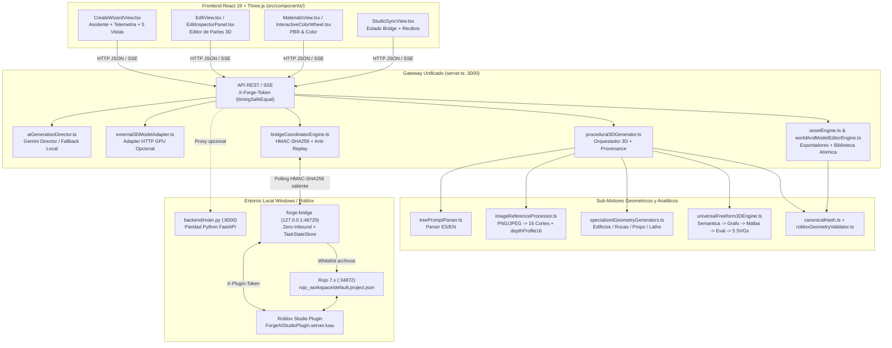
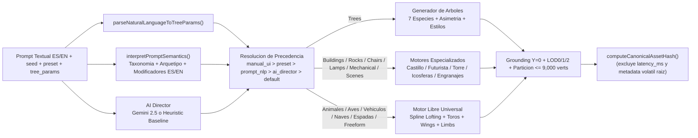
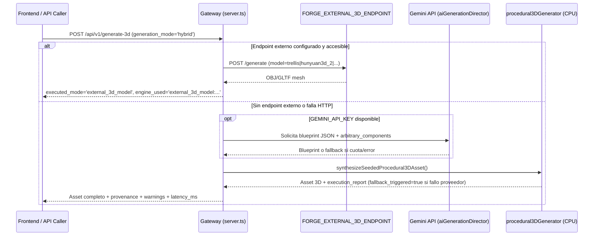
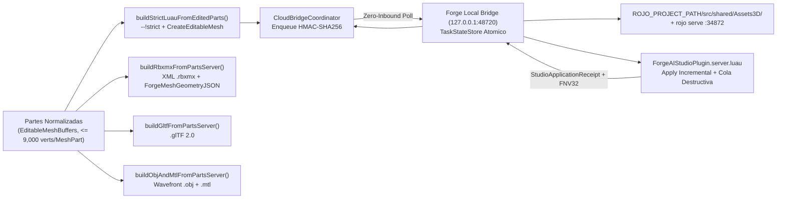
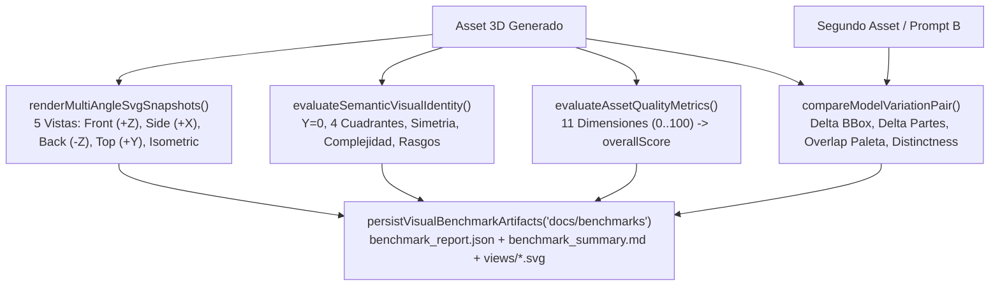

# Arquitectura del Sistema — NIGHTMARE FORGE / Forge AI Studio

Este documento describe la arquitectura integral de **NIGHTMARE FORGE / Forge AI Studio v2.3.0**: frontend interactivo, gateway Express + Vite, motores de generación 3D híbrida en TypeScript, paridad Python FastAPI, adaptador opcional de modelos 3D externos, evaluación visual multi-vista, hashing canónico e integración con Roblox Studio y Rojo 7.x.

---

## 1. Diagrama de Flujo General del Sistema

---

## 2. Diagrama Text-to-3D Híbrido (Con Provenance y Sin Plantillas Rígidas)

---

## 3. Diagrama Image-to-3D

```mermaid
flowchart LR
    Ref["Base64 PNG / JPEG"] --> Dec["Decodificacion Binaria Real RGBA"]
    Dec --> Seg["Segmentacion Primer Plano\nAlpha < 45 o Distancia Fondo"]
    Seg --> Scan["16 Cortes Verticales\nwidthProfile16 + depthProfile16 + sliceHex"]
    Scan --> Sym["estimatedSymmetryScore + volumetricConfidence"]
    Scan & Sym --> Fam["inferredObjectFamily\ntree | tower | animal | vehicle | lamp | rock | wide | composite"]
    Fam --> Lathe["generateReferenceImage3DAssetParts()\nbuildLatheSilhouetteMesh(..., depthProfile)"]
    Lathe --> IoU["evaluateReferenceVsModelMetrics()\nsilhouetteMatchIoU + volumetricMatchScore"]
```

---

## 4. Diagrama Motor Híbrido con Proveedor GPU Externo y Fallback Honesto

---

## 5. Diagrama Exportación y Sincronización con Roblox Studio

---

## 6. Diagrama de Evaluación Visual y Calidad Multi-Ángulo

