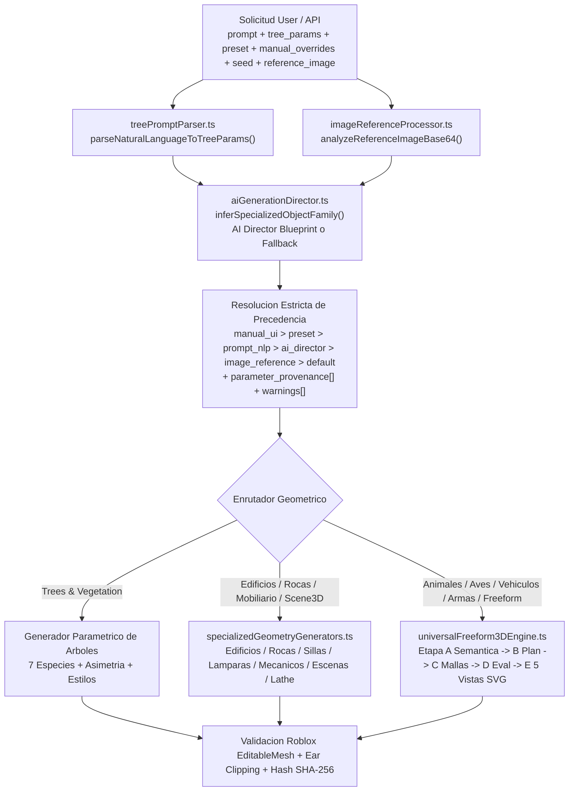

# Motor de Generación 3D Híbrida — NIGHTMARE FORGE

Este documento describe en profundidad la arquitectura interna del motor de generación 3D: resolución y trazabilidad de parámetros, parser NLP determinista, generador parametrizado de árboles, motores geométricos especializados, motor universal libre y restricciones estrictas de Roblox `EditableMesh`.

---

## 1. Capas del Pipeline de Generación (`synthesizeSeededProcedural3DAsset`)

---

## 2. Trazabilidad y Precedencia de Parámetros (`parameter_provenance`)

Históricamente, los valores iniciales enviados por la interfaz sobrescribían los atributos extraídos del prompt (por ejemplo, manteniendo verde o 14 studs pese a pedir `"hojas azules"` o `"5 studs"`). El motor ahora resuelve cada parámetro siguiendo jerarquía estricta:

`manual_ui` > `preset` > `prompt_nlp` > `ai_director` > `image_reference` > `default`

Cada respuesta incluye:
- **`parameter_provenance`**: arreglo de entradas `{ parameter, value, source, previousValue? }`. Por ejemplo, cuando `"hojas rojas"` y `"5 studs"` vencen a `preset`/`default`, quedan registrados con `source: 'prompt_nlp'`; si el usuario bloquea `manual_overrides: ['height']`, registra `source: 'manual_ui'`.
- **`warnings`**: alertas explícitas cuando un parámetro manual entra en conflicto con el prompt o es ajustado por límites seguros de Roblox.
- **`execution_report`**: incluye `requested_mode`, `executed_mode`, `provider`, `model_used`, `provider_status`, `generation_stage`, `latency_ms`, `fallback_triggered`, `fallback_reason`, `seed` y `seed_preserved`.
- **Determinismo vs Semilla Automática**: cuando se proporciona una semilla explícita (y no es un placeholder UI como `'forge-tree-2026'`), el `contentHash` y `geometryHash` excluyen métricas temporales (`latency_ms`, `execution_report`) para garantizar determinismo bit-a-bit. Si se omite la semilla, cada generación crea una semilla única irrepetible.

---

## 3. Parser NLP y Generador Parametrizado de Árboles (7 Especies)

Archivo: `src/utils/treePromptParser.ts` + `src/server/engines/procedural3DGenerator.ts` (`generateParameterizedTree3DParts`).

### 3.1 Rasgos y Rangos Extraídos por `parseNaturalLanguageToTreeParams`
- **Escala dimensional**: altura mínima reducida a `2.5` studs (ej. `5 studs`), máxima `80` studs, escalando proporcionalmente `width` y `trunkThickness` en árboles enanos o gigantes.
- **Especies (`TreeSpeciesType`)**: `oak`, `pine`, `willow`, `bonsai`, `dead`, `fantasy`, `crystalline`. *(Nota: `'ciprés'` mantiene `species: 'oak'` con `canopyShape: 'conical'` para compatibilidad con métricas históricas).*
- **Estilos y Modificadores**: `cartoon`, `realistic`, `stylized`, `lowpoly`, `crystal` (`TreeVisualStyleType`), más `asymmetricBranches`, `crystallineCanopy` y `emissiveLeaves`.

### 3.2 Geometría Diferenciada por Especie
- **`bonsai`**: Genera `BonsaiCeramicPot` (maceta biselada) y `BonsaiSoilBed` en la base.
- **`dead`**: Genera tronco y `DeadSnagSpire` + ramas secas `BareTwig_1..4` con **0 hojas** (`leafClusters = []`).
- **`pine`**: Múltiples pisos cónicos apilados (`PineTier_2..4`) con conicidad descendente.
- **`willow`**: Copa superior combinada con frondas colgantes laterales (`WillowFrond_1..6`).
- **`fantasy`**: Añade cristales arcanos emisivos (`ArcaneCrystal_1..4`, material `Neon`) y acentos bioluminiscentes.
- **`crystalline`**: Genera prismas cristalinos facetados (`CrystalCrownShard_1..4`) en materiales `Ice` / `Glass` / `Neon`.
- **Asimetría y Cartoon**: `asymmetricBranches` varía ángulos y longitudes de ramas (factores `1.48x` y `0.56x`); estilo `cartoon` prioriza `SmoothPlastic`.
- *(Compatibilidad legacy)*: Árboles `oak` / `ciprés` clásicos sin `target_poly_budget` ni modificadores especiales conservan exactamente 13 partes base (`RootFlare`, `MainTrunk`, 4 ramas y follaje) exigidas por pruebas de regresión E2E.

---

## 4. Motor Universal Libre (`universalFreeform3DEngine.ts`) y Sub-motores Especializados

Para evitar que cualquier objeto no contemplado caiga en `chest_or_prop`, el sistema implementa 5 etapas puras en `universalFreeform3DEngine.ts`:
1. **Etapa A (`interpretPromptSemantics`)**: Detecta taxonomía (`quadruped_animal`, `winged_creature`, `wheeled_vehicle`, `biped_humanoid_or_statue`, `vegetation_or_tree`, `architecture_or_building`, `freeform_composite`) y arquetipo exacto. Incluye detección robusta Unicode sin fallos por `\b` ante tildes (`árbol`, `pájaro`, `automóvil`).
   - **Animales**: vaca (`bovine_cow`), caballo (`equine_horse`), perro (`canine_dog`), dragón (`winged_dragon`), ave/pájaro (`bird_or_avian` con pico, alas plumadas y patas). Modificadores ES/EN para tamaño (`pequeña`/`small`, `grande`/`large`), color de pelaje (`blanca`, `marrón`/`brown`) y cuernos largos (`cuernos largos`/`long horns`).
   - **Vehículos**: motocicleta de 2 ruedas (`motorcycle`), automóvil de 4 ruedas con parabrisas y faros (`wheeled_car_or_truck`), nave espacial futurista con alas delta, cabina y propulsores `Neon` (`futuristic_spaceship`).
   - **Objetos complejos**: espada (`sword_or_weapon` con pomo, empuñadura, guarda, hoja biselada y canal), estatua humana (`human_statue` con pedestal, pelvis, torso, cabeza, brazos y piernas).
2. **Etapa B (`planGeometryAndComponents`)**: Construye el grafo jerárquico anatómico o mecánico (con soporte para `arbitrary_components` generados por IA).
3. **Etapa C (`generateReal3DMeshesFromPlan`)**: Ejecuta kernels geométricos reales (`spline_lofted_organ`, `sculpted_icosphere_organ`, `extruded_wheel_torus`, `aerodynamic_wing_foil`, `surface_patch_decal`, `beveled_structural_frame`, `tapered_limb_chain`), con LOD0/LOD1/LOD2 cerrados.
4. **Etapa D (`evaluateSemanticVisualIdentity`)**: Evalúa apoyo en `Y=0`, 4 cuadrantes en cuadrúpedos, perfil longitudinal cráneo-caudal, simetría bilateral, complejidad orgánica no primitiva y cobertura de rasgos (`coverageRatio >= 0.85`, score >= 82).
5. **Etapa E (`renderMultiAngleSvgSnapshots`)**: Genera 5 vistas ortográficas/isométricas SVG con iluminación básica por caras: **Frontal (`+Z`)**, **Lateral (`+X`)**, **Trasera (`-Z`)**, **Superior (`+Y`)** e **Isométrica 3/4**.

### Subtipos Arquitectónicos en `specializedGeometryGenerators.ts`
`generateSpecializedBuildingAssetParts()` preserva `SteppedStoneFoundation` y diferencia automáticamente:
- **`medieval_castle`**: Añade `CentralKeep_Tower` y 4 almenas `BattlementMerlon_1..4` con tejado estilo `crenellated`.
- **`futuristic_building`**: Añade `NeonExoskeleton_Rib_1..2` (`Neon`) y `OrbitalSpire_Antenna` (`Metal`).
- **`fantasy_tower`**: Añade `UpperObservatorySpire` y cristales orbitantes `FloatingRuneCrystal_1..3` en `Neon`.

---

## 5. Invariantes de Malla y Límites Roblox `EditableMesh`

- **Pivote en el suelo**: Todas las piezas normalizadas reposan con `minY = 0` (`groundAndNormalizeParts`).
- **Límites por sub-malla**: `validateProcedural3DGeometry` verifica `vertices <= 9,000` y `faces <= 9,500` por partición segura (límite duro de Roblox Engine: `20,000` vértices / `20,000` caras) y exige **0 triángulos degenerados**.
- **Monotonicidad LOD**: Cada `MeshData` empaqueta 3 niveles de detalle (`lodLevels[0] > lodLevels[1] >= lodLevels[2]`).
- **Colores canónicos**: Soportan `#RRGGBB`, tuplas `[r, g, b]` 8-bit y normalizado float, con paridad verificada TypeScript ↔ Luau (`rgbColorParity.test.ts`).
