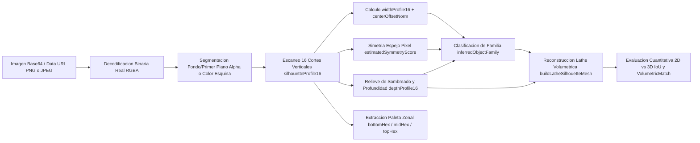

# Pipeline Image-to-3D — NIGHTMARE FORGE

Este documento explica el alcance real, los algoritmos implementados en local y las capacidades externas opcionales del sistema **Image-to-3D** en **NIGHTMARE FORGE**, incluyendo soporte multi-vista (`reference_images_multi` / `analyzeMultiViewReferenceImages`) y reporte explícito de incertidumbre por oclusión (`uncertaintyReport`).

---

## 1. Arquitectura General del Flujo Image-to-3D

El núcleo local reside en `src/server/engines/imageReferenceProcessor.ts`, conectado con el generador de revolución/profundidad `generateReferenceImage3DAssetParts()` (`src/server/engines/specializedGeometryGenerators.ts`) y el orquestador `synthesizeSeededProcedural3DAsset()` (`src/server/engines/procedural3DGenerator.ts`).

---

## 2. Etapas Implementadas en Local (`imageReferenceProcessor.ts`)

### 2.1 Decodificación Real de PNG y JPEG

- **PNG**: Valida firma PNG (`89 50 4E 47 0D 0A 1A 0A`), lee el chunk `IHDR` (ancho, alto, profundidad de bits 8-bit, colorType RGB/RGBA), descomprime `IDAT` con `zlib.inflateSync` y revierte los filtros de scanline (`None`, `Sub`, `Up`, `Average`, `Paeth`). En Python, `validate_and_decode_png_bytes` en `backend/engines/asset_engine.py` provee paridad de validación.
- **JPEG**: Parsea marcadores SOF0 / SOF2 para obtener dimensiones reales y muestrea luminancia/color cuando corresponde.
- Si el buffer no puede decodificarse como PNG/JPEG válido, devuelve métricas de fallback seguro marcando `validImageDecoded: false`.

### 2.2 Segmentación Fondo vs Objeto y Perfil de 16 Cortes (`silhouetteProfile16`)

1. Analiza las 4 esquinas para detectar si la imagen usa canal alfa transparente (`bgA < 200`) o color de fondo sólido.
2. Calcula el cuadro delimitador del primer plano (`bboxWidthPx`, `bboxHeightPx`, `aspectRatioWidthToHeight`, `foregroundCoverage`).
3. Divide el alto del objeto en **16 franjas verticales** de base (`yNorm = 0`) a cima (`yNorm = 1`), extrayendo por cada corte:
   - `widthNorm`: anchura horizontal normalizada (`0.06..1.0`).
   - `centerOffsetNorm`: desplazamiento del centro respecto al eje vertical (`-0.45..0.45`).
   - `sliceHex`: color dominante promedio en formato canónico `#RRGGBB`.

### 2.3 Simetría por Espejo y Perfil Volumétrico de Profundidad (`depthProfile16`)

Como mejora incorporada en esta misión, `analyzeReferenceImageBase64` calcula ahora:
- **`estimatedSymmetryScore`**: combina la alineación del eje central con la coincidencia píxel a píxel entre el lado izquierdo y derecho de cada corte horizontal (`pixelMirrorAccum`).
- **`depthProfile16` (`depthNorm` por corte)**: estima la profundidad relativa en el eje `Z` a partir de la anchura del corte, la envolvente vertical de volumen y el **gradiente de luminancia centro-vs-borde** (`shadingRelief`), evitando que la extrusión Z sea una copia plana e invariante de la anchura X.
- **`volumetricConfidence`**: indicador agregado (`0.15..0.99`) basado en cobertura de primer plano, simetría espejo y decodificación válida.

### 2.4 Clasificación de Familias e Integración Geométrica

`inferredObjectFamily` clasifica automáticamente la silueta en:
- `'tree_or_foliage'` (copa ancha sobre tronco estrecho)
- `'tower_or_column'` (relación de aspecto estrecha `< 0.58` con base firme)
- `'vehicle_or_craft'` (relación ancha `>= 1.32` y base inferior estable)
- `'animal_or_creature'` (torso medio voluminoso con asimetría cráneo-caudal o patas inferiores)
- `'lamp_or_vessel'` (cintura estrecha entre base y corona amplia)
- `'wide_structure'` (relación `> 1.25`)
- `'organic_rock'` (baja simetría `< 0.78`)
- `'composite_prop'` (caso general)

En `specializedGeometryGenerators.ts`, `generateReferenceImage3DAssetParts()` utiliza tanto `widthProfile16` como `depthProfile16` en `buildLatheSilhouetteMesh()` para reconstruir base, cuerpo y corona en 3D respetando la proporción Z específica de criaturas/vehículos (`depthScale = 0.72` vs `0.92`), y genera apéndices laterales en la altura de máxima anchura.

### 2.5 Evaluación Cuantitativa 2D vs 3D (`evaluateReferenceVsModelMetrics`)

Compara las 16 franjas reales del modelo 3D generado (`widthProfileModel16`, `depthProfileModel16`) contra las franjas extraídas de la imagen (`widthProfile16`, `depthProfile16`) y reporta:
- `silhouetteMatchIoU`: Intersection-over-Union 1D combinada con similitud de relación de aspecto.
- `volumetricMatchScore`: puntuación combinada ancho + profundidad Z (`0.15..0.99`).
- `extractedPaletteHex`: terna de colores reales de base, centro y cima.

---

## 3. Alcance Honesto y Limitaciones Actuales

| Aspecto | Estado Real | Explicación Técnica |
| :--- | :--- | :--- |
| Decodificación PNG/JPEG y perfil 16 cortes | **Implementado y probado** | Se ejecuta localmente en CPU sin dependencias externas. |
| Profundidad volumétrica estimada (`depthProfile16`) y IoU 2D↔3D | **Implementado y probado** | Modula realmente el eje Z en `buildLatheSilhouetteMesh` usando relieve de luminancia y simetría. |
| Reconstrucción Multi-Vista / Neural Single-Image-to-3D (gaussianas/SDF) | **Solo vía adaptador GPU externo (`FORGE_EXTERNAL_3D_ENDPOINT`)** | Modelos neuronales como `TRELLIS`, `SF3D`, `TripoSR` y `Hunyuan3D-2.0` requieren GPU CUDA local/remota; en el entorno actual sin endpoint externo el motor usa reconstrucción geométrica por revolución multi-zona + motor híbrido de silueta. |
